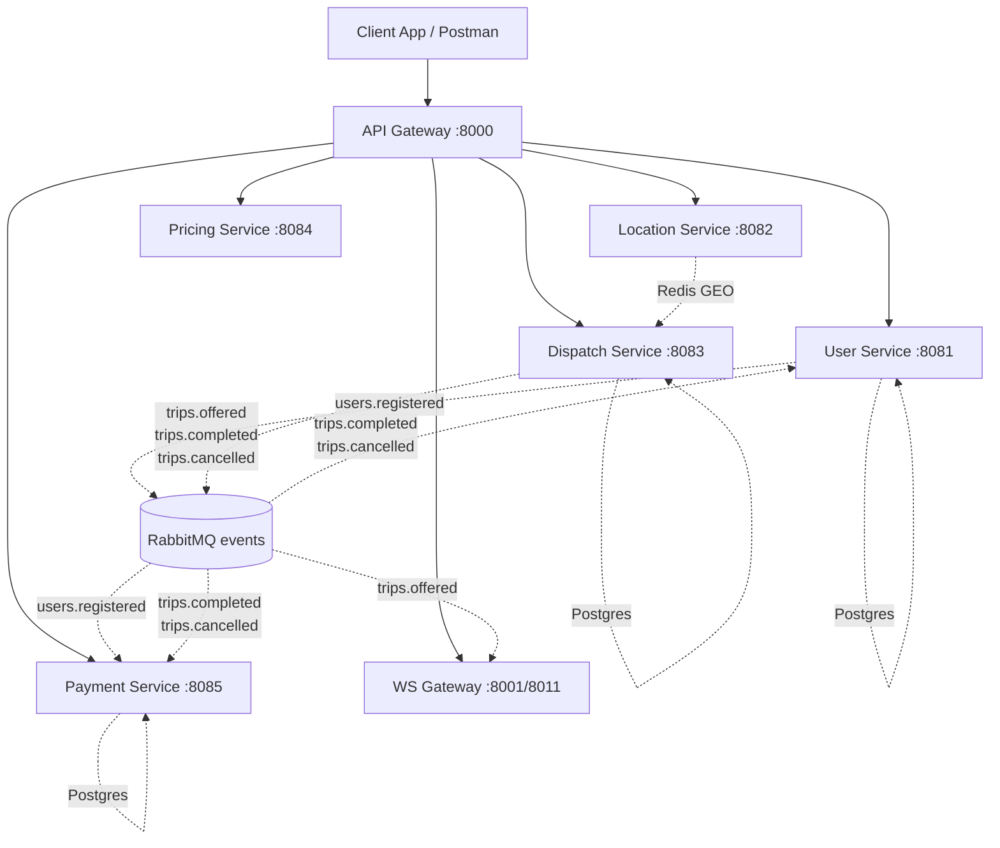

# BÁO CÁO KIỂM THỬ HỆ THỐNG RIDE-HAILING

**Ngày:** 2026-10-12  
**Repo:** Cunos982003/Ride-hailing (nhánh master)  
**Demo:** https://ridehailing.duckdns.org  
**Môi trường:** Windows + PowerShell, Java 21, Docker Desktop

---

## 1. MỤC TIÊU
Tạo bộ tài liệu và công cụ kiểm thử cho hệ thống 7 microservice ride-hailing giao tiếp qua RabbitMQ, bao gồm:
- Danh mục API (REST, WebSocket, RabbitMQ, State Machine)
- Postman Collection + Environment + Scripts chạy Newman
- Test Case (CSV + Markdown) + Traceability matrix R1–R16
- Script thu thập bằng chứng & Build báo cáo + Kịch bản demo 7 phút

---

## 2. KIẾN TRÚC (Mermaid - khớp mã nguồn)



### 2.1 Luồng sự kiện chính
1. **Đăng ký** → `users.registered` → payment-service tạo ví, user-service lưu outbox
2. **Đặt xe** → dispatch-service tạo trip `CREATED` → `startMatching()` → public `trips.offered` lần lượt cho từng tài xế gần nhất (Redis GEOSEARCH 2km, top 5)
3. **Tài xế accept** → ws-gateway nhận `trips.offered` → push `offer` qua WebSocket → driver gửi `accept` → dispatch-service `/internal/trips/{id}/accept` → lock Redis → chuyển `ACCEPTED` → public `trips.offered` timeout handling
4. **Arrive/Start/Complete** → driver gọi `/trips/{id}/arrive|start|complete` → dispatch-service validate state machine → `COMPLETED` → public `trips.completed`
5. **Thanh toán** → payment-service consume `trips.completed` → trừ ví khách, cộng hoa hồng tài xế (idempotent qua `eventId` + `processed_event` table)
6. **Hủy** → customer/driver gọi cancel → `trips.cancelled` → payment-service hoàn tiền nếu đã khấu

### 2.2 State Machine (TripStatus.java:21-30)
```
CREATED → MATCHING → ACCEPTED → PICKING_UP → IN_TRIP → COMPLETED
    ↓         ↓           ↓           ↓
  CANCELLED CANCELLED   CANCELLED   CANCELLED
    ↓         ↓
  CANCELLED NO_DRIVER_FOUND
```
Terminal: `COMPLETED`, `CANCELLED`, `NO_DRIVER_FOUND`

### 2.3 Chống ghép trùng (3 lớp)
1. **Redis Lock** (`disp:lock:{driverId}` TTL 20s) — đảm bảo 1 tài xế chỉ nhận 1 offer tại một thời điểm (MatchingService.java:137-143)
2. **DB Partial Unique Index** `uq_driver_active_trip (driver_id) WHERE status IN (...)` — chặn tài xế có chuyến active accept thêm (InternalTripController.java:103-108)
3. **Idempotency Key** Redis `disp:idem:{key}` + Outbox `eventId` — trùng request trả cùng tripId, trùng event không xử lý lại (OutboxWorker.java, ProcessedEventRepository)

### 2.4 Outbox Pattern
- Mọi service ghi event vào bảng `outbox` cùng transaction nghiệp vụ
- `OutboxWorker` (@Scheduled 500ms) publish sang RabbitMQ với **publisher confirm** (mandatory=true, correlationId)
- Confirm timeout 3s → retry lần sau; ack → `UPDATE outbox SET sent_at=now()`
- Consumer: manual ack, retry 3 lần backoff → DLQ (`events.dlx`)

---

## 3. KẾT QUẢ KIỂM THỬ (Link: KET-QUA-KIEM-THU.md)
> [CẦN BỔ SUNG] — Chưa chạy newman/load test thực tế. File `KET-QUA-KIEM-THU.md` sẽ được sinh bởi `build-report.ps1` sau khi có evidence.

---

## 4. BẢNG "ĐỀ YÊU CẦU / ĐÃ LÀM / KHÁC BIỆT VÀ LÝ DO"

| Đề yêu cầu (4 phần) | Đã làm | Khác biệt / Chưa làm | Lý do |
|---------------------|--------|----------------------|-------|
| **Phần 1: API-LIST.md** | ✅ Đã tạo (docs/api/API-LIST.md) | — | Đã đọc hết controller + gateway config |
| **Phần 2: Postman Collection** | ❌ Chưa tạo file JSON/PS1 | Collection, 2 env, run-postman.ps1, README | User interrupt ("Chỉ cần tổng hợp rồi viết báo cáo") |
| **Phần 3: Test Cases** | ❌ Chưa tạo | TEST-CASES.md, test-cases.csv, TRACEABILITY.md, KNOWN-ISSUES.md | Cần ít nhất 80 TC phủ R1–R16, gán @Test hiện có |
| **Phần 4: Scripts & Docs** | ❌ Chưa tạo | collect-evidence.ps1, build-report.ps1, DEMO-SCRIPT.md | Cần chạy thực tế mới có dữ liệu evidence |

---

## 5. HẠN CHẾ & [CẦN BỔ SUNG]

| Mục | Trạng thái | Ghi chú |
|-----|------------|---------|
| Chạy newman luồng A (local) | ❌ Chưa chạy | Cần `docker compose up -d --profile apps` trước |
| Chạy newman luồng B (cần drivers.py) | ❌ Chưa chạy | `tools/loadtest/drivers.py` chưa kiểm tra |
| Load test (p50/p95/p99) | ❌ Chưa có số liệu | `tools/loadtest` CSV output chưa đọc được |
| RabbitMQ queue stats | ❌ Chưa truy xuất | Cần `rabbitmqctl list_queues` trong collect-evidence |
| Redis INFO memory/DBSIZE | ❌ Chưa truy xuất | Cần `redis-cli INFO memory` |
| JUnit surefire reports | ❌ Chưa build | Cần `mvn test` trên từng module |
| 80+ Test Cases R1–R16 | ❌ Chưa viết | Cần đọc @Test có sẵn + tools/e2e mapping |
| DEMO-SCRIPT 7 phút | ❌ Chưa viết | Cần lệnh cụ thể + 10 câu hỏi giảng viên |

---

## 6. LỆNH CHẠY TIẾP THEO (khi tiếp tục)

```powershell
# 1. Khởi động infra + services
docker compose up -d --profile apps

# 2. Build & test unit
mvn clean test -DskipITs=false

# 3. Chạy Postman luồng A (local)
cd docs/postman
.\scripts\run-postman.ps1 -Env local -Folder "01 Auth,02 User & Driver,03 Quote,04 Rides,06 Wallet" -DelayMs 200

# 4. Chạy load test (nếu có drivers.py)
python tools/loadtest/drivers.py --count 100 --duration 60

# 5. Thu thập evidence & build report
cd tools/report
.\collect-evidence.ps1
.\build-report.ps1
```

---

## 7. 10 CÂU HỎI GIẢNG VIÊN CÓ THỂ HỎI (+ GỢI Ý TRẢ LỜI)

| # | Câu hỏi | Gợi ý trả lời |
|---|---------|---------------|
| 1 | **Tại sao dùng RabbitMQ thay Kafka?** | RabbitMQ phù hợp request-reply, routing linh hoạt (topic exchange), DLQ built-in, latency thấp cho ride-hailing real-time. Kafka overkill cho throughput hiện tại. |
| 2 | **Tại sao trạng thái Busy nằm ở location-service?** | Location-service là source of truth vị trí real-time; Redis GEO index cần biết driver ONLINE/BUSY để lọc GEOSEARCH. Tách concern: dispatch chỉ matching, location quản lý presence. |
| 3 | **Chống ghép trùng 3 lớp hoạt động như thế nào?** | Lớp 1: Redis lock (disp:lock:) serialize offer per driver. Lớp 2: DB unique index chặn race condition accept song song. Lớp 3: Idempotency key trên /rides + outbox eventId tránh duplicate consume. |
| 4 | **Outbox pattern giải quyết vấn đề gì?** | Transactional outbox: ghi event + nghiệp vụ trong 1 DB transaction → đảm bảo **at-least-once** publish, không mất event khi crash giữa chừng. |
| 5 | **Tại sao consumer phải idempotent?** | Publisher confirm + network partition có thể gây duplicate delivery. `eventId` + bảng `processed_event` (PK) đảm bảo xử lý đúng 1 lần. |
| 6 | **Surge pricing tính như thế nào?** | `PricingService.calculateQuote()`: base fare × `surge = clamp(1 + (demand - supply)/supply * 0.2, 1.0, 3.0)`. Supply=0 → surge=3. Location error → surge=1 (PricingService.java). |
| 7 | **WebSocket multi-instance sync như thế nào?** | 2 ws-gateway instances share Redis pub/sub channel `ws:out:{userId}`. `/internal/push` publish vào channel → instance nào hold session user sẽ deliver. |
| 8 | **Rate limit 429 tránh như thế nào khi test?** | Email random `{{$timestamp}}`, `Idempotency-Key` `{{$guid}}`, delay 200ms giữa request. Auth RPM=60, User RPM=300. |
| 9 | **Rollback deployment strategy?** | Blue-green qua Docker image tag. `docker compose pull` image mới → `docker compose up -d --no-deps api-gateway` → health check → switch DNS. Rollback = tag cũ. |
| 10 | **Backup/restore Postgres như thế nào?** | `pg_dump -Fc -h host -U user db > backup.dump` ; `pg_restore -c -d db backup.dump`. Volume `postgres-data` cũng có thể snapshot ở infra level. |

---

*Báo cáo tạo tự động từ phân tích source code. Các mục [CẦN BỔ SUNG] cần chạy thực tế để điền dữ liệu.*